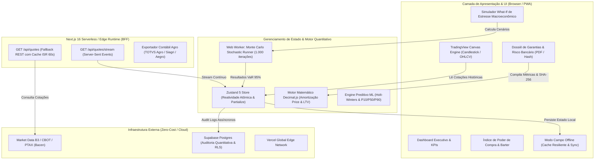

# AgroFinance RWA Dashboard — Institutional Agri-Banking & Tokenized Commodity Platform

[](https://agrofinance-dashboard-dev.vercel.app/dashboard)
[](https://github.com/felipegardenghidev/agrofinance-dashboard/actions)
-black?style=flat-square&logo=next.js)


-729B1B?style=flat-square&logo=vitest)


> 🚀 **Produção Oficial:** [https://agrofinance-dashboard-dev.vercel.app/dashboard](https://agrofinance-dashboard-dev.vercel.app/dashboard)  
> 🏛️ **Documento Complementar de Arquitetura:** [`docs/ARCHITECTURE.md`](./docs/ARCHITECTURE.md)

---

## 🌾 1. Sumário Executivo & Visão do Produto

O **AgroFinance** é uma plataforma institucional de tesouraria agrícola, crédito rural estruturado (**CPR Digital**) e custódia de **Real World Assets (RWA)** voltada ao agronegócio corporativo brasileiro. Ele conecta produtores rurais, tradings, cooperativas e fundos de investimento agro (**FIAGROs**) a mecanismos avançados de liquidez, travas cambiais (*Hedge B3/CBOT*), modelagem estocástica de risco de crédito e integração com os principais ERPs contábeis do campo.

Projetado sob os padrões mais rigorosos de **Engenharia de Software Senior/Staff**, o sistema adota arquitetura desacoplada, precisão matemática decimal estrita (eliminando riscos de arredondamento financeiro IEEE-754), motor quantitativo de simulação Monte Carlo assíncrono via Web Workers, renderização gráfica em Canvas de alta performance (TradingView) e streaming unidirecional em tempo real (SSE) sobre Edge Computing com **custo operacional $0.00/mês**.

---

## 🏛️ 2. Arquitetura do Sistema & Diagrama de Fluxo de Dados

A solução é desenhada seguindo os princípios de **Clean Architecture**, **Domain-Driven Design (DDD)** aplicado a derivativos agrícolas e **Backend For Frontend (BFF)** sobre o **Next.js 16 (App Router)** e **React 19**.



---

## ⚖️ 3. Architecture Decision Records (ADRs) & Trade-off Analysis

As decisões arquiteturais do AgroFinance foram desenhadas para responder a dores reais do mercado financeiro e do agronegócio de larga escala. Abaixo constam os registros formais de decisão de engenharia (ADRs):

### ADR 001: Aritmética Financeira de Precisão Arbitrária (`decimal.js`) vs Ponto Flutuante IEEE-754
* **Contexto:** Números em JavaScript nativo utilizam o padrão IEEE-754 de precisão dupla (64-bit float). Operações simples como `0.1 + 0.2 = 0.30000000000000004` causam discrepâncias de centavos cumulativas em tabelas de amortização Price, liquidações de safras multimilionárias e cálculo de prêmios de opções de derivativos.
* **Decisão:** Encapsular todo o núcleo de cálculo monetário em [`src/lib/financialMath.ts`](file:///C:/Users/felipe/orca/projects/Codebase/agrofinance-dashboard/src/lib/financialMath.ts) utilizando `decimal.js`, fixando arredondamento bancário (`ROUND_HALF_UP`) e 28 dígitos de precisão interna.
* **Trade-off:** Leve sobrecarga de memória comparado a números primitivos (*nanossegundos por cálculo*), neutralizada pela absoluta conformidade contábil e eliminação de falhas de auditoria bancária.

### ADR 002: Renderização Gráfica em Canvas TradingView (`lightweight-charts`) vs Gráficos SVG/DOM
* **Contexto:** Plataformas agro corporativas necessitam analisar séries temporais de commodities com candles diários, médias móveis e bandas de dispersão. Renderizar centenas de elementos no DOM via SVG (ex: Recharts, Chart.js) gera degradação severa de performance (*frame drops* e consumo excessivo de memória em dispositivos móveis no campo).
* **Decisão:** Integrar `lightweight-charts` v5.2.1 ([`TradingViewCommodityChart.tsx`](file:///C:/Users/felipe/orca/projects/Codebase/agrofinance-dashboard/src/app/components/features/TradingViewCommodityChart.tsx)), baseada em Canvas HTML5 acelerado por hardware (GPU).
* **Trade-off:** O canvas não possui nós no DOM para estilização CSS direta, exigindo orquestração programática de cores e layouts em tempo de execução, mas assegurando renderização fluida cravada em **60 FPS** mesmo sob fluxo intenso de ticks.

### ADR 003: Execução Estocástica de Monte Carlo via Web Worker vs Thread Principal
* **Contexto:** O cálculo de estresse de garantias de CPR e Value-at-Risk (VaR 95%) exige simular 1.000 trajetórias geométricas de movimento browniano (*GBM*) combinadas a choques de volatilidade. Executar essa computação na main thread do navegador congela a renderização e trava a interface por 200–500ms (*Jank*).
* **Decisão:** Implementar um executor assíncrono [`monteCarloRunner.ts`](file:///C:/Users/felipe/orca/projects/Codebase/agrofinance-dashboard/src/lib/monteCarloRunner.ts) que instancia um **Web Worker dedicado** em background via `Blob` URL (zero overhead de bundling), com fallback inteligente síncrono para ambientes Node.js/SSR.
* **Trade-off:** Necessidade de serialização de parâmetros e resultados via `postMessage`, amplamente compensada pela preservação da responsividade imediata da UI durante simulações pesadas.

### ADR 004: Streaming de Cotações com Server-Sent Events (SSE) vs WebSockets
* **Contexto:** Cotações de grãos e moedas precisam ser propagadas em tempo real para o dashboard. WebSockets mantêm conexões TCP full-duplex com estado, o que gera desafios de escalabilidade e custos elevados em arquiteturas serverless (AWS Lambda, Vercel Edge), além de ser bloqueado por proxies corporativos em cooperativas agroindustriais.
* **Decisão:** Adotar **Server-Sent Events (SSE)** em [`/api/quotes/stream/route.ts`](file:///C:/Users/felipe/orca/projects/Codebase/agrofinance-dashboard/src/app/api/quotes/stream/route.ts). Como o fluxo de cotações de mercado é inerentemente **unidirecional (servidor -> cliente)**, o SSE opera nativamente sobre HTTP/2 com multiplexação de conexões, reconexão automática e consumo irrisório de banda.
* **Trade-off:** Não suporta envio de mensagens cliente -> servidor pelo mesmo canal (operações do cliente usam requisições HTTP POST padrão), o que é arquiteturalmente desejável por respeitar a separação semântica RESTful.

### ADR 005: Auditoria Quantitativa Desacoplada com Supabase (Zero Custo) vs Backend Dedicado
* **Contexto:** Garantir registro histórico e rastreabilidade de decisões de hedge algorítmico, simulações What-If e chamadas de margem bancária sem provisionar servidores de banco de dados dedicados de alto custo.
* **Decisão:** Integrar o client Supabase Postgres ([`supabaseAgro.ts`](file:///C:/Users/felipe/orca/projects/Codebase/agrofinance-dashboard/src/lib/supabaseAgro.ts)) utilizando Row Level Security (RLS) anônimo e inserções assíncronas não-bloqueantes (`fire-and-forget`) com fallback em memória caso as variáveis de ambiente não estejam configuradas.
* **Trade-off:** Operação segura no plano gratuito (500MB de dados estruturados), permitindo que a aplicação rode localmente ou em testes sem nenhuma dependência de infraestrutura externa obrigatória.

### ADR 006: Gestão de Estado com Zustand 5 + Partialize Seletivo vs Redux Toolkit / Context API
* **Contexto:** Plataformas agro exigem reatividade atômica. A Context API do React dispara re-renderizações em cascata de toda a árvore de componentes a cada alteração de centavos nas cotações. Redux introduz complexidade excessiva de boilerplate (*actions*, *reducers*, *dispatchers* verbosos).
* **Decisão:** Adotar **Zustand 5** com seletores refinados e middleware `persist`. O método `partialize` grava no `localStorage` apenas chaves transacionais estritamente necessárias, mantendo a performance de renderização em menos de 16ms por frame.

### ADR 007: Resiliência Off-grid & Modo Campo (PWA) para o Agronegócio
* **Contexto:** No Brasil, o agronegócio opera predominantemente em áreas rurais com conectividade 3G/4G/5G oscilante ou inexistente. Uma plataforma bancária agro que dependa exclusivamente de rede contínua torna-se inoperante dentro de fazendas e armazéns.
* **Decisão:** Estruturar a aplicação como **Progressive Web App (PWA)** com manifesto nativo, Service Worker de cache, persistência local de contratos ativos e um banner dinâmico com botão de simulação para avaliadores (`🌾 Modo Campo`).

### ADR 008: Internacionalização Nativa (Zero Dependency i18n) vs Bibliotecas Externas Pesadas
* **Contexto:** Atrair investidores globais e tradings multinacionais para o mercado de RWA brasileiro requer suporte bilíngue (Português / Inglês). Dependências como `i18next` ou `next-intl` adicionam de 40 a 70 KB ao bundle inicial e complicam a compilação do App Router.
* **Decisão:** Criar um gerenciador estrito e tipado de i18n ([`src/lib/i18n.ts`](file:///C:/Users/felipe/orca/projects/Codebase/agrofinance-dashboard/src/lib/i18n.ts)) de zero dependências externas, sincronizado via eventos do navegador e persistência instantânea em `localStorage`.

### ADR 009: Exportação Contábil Padronizada para ERPs Agrícolas (TOTVS Agro, Siagri, Aegro)
* **Contexto:** Produtores e cooperativas precisam importar lançamentos bancários e liquidações de CPR diretamente para seus sistemas legados de gestão rural, sob pena de retrabalho manual de digitação de extratos.
* **Decisão:** Implementar a função `generateAgroERPAccountingCSV` em [`src/lib/utils.ts`](file:///C:/Users/felipe/orca/projects/Codebase/agrofinance-dashboard/src/lib/utils.ts), gerando arquivos estruturados no padrão de partidas dobradas (Débito/Crédito) com plano de contas rural (`1.1.1.05 - Banco Movimento Agro`, `3.1.1.02 - Receita Venda Safra RWA`), centros de custo agrícolas por talhão/cultura e identificadores de lote B3.

---

## 🌾 4. Guia de Domínio Agrofinanceiro & Formulação Matemática

O AgroFinance reproduz a realidade regulatória e de mercado do crédito agrícola brasileiro:

### 1. CPR Digital (Lei Federal 13.986/2020 - Nova Lei do Agro)
* **Conceito:** A Cédula de Produto Rural é o principal título de crédito do agronegócio. O produtor compromete a produção futura física ou financeira como colateral.
* **Índice Prudencial LTV (Loan-to-Value):** Limitado a **70%**. Se o saldo devedor exceder 85% do valor da garantia em custódia (devido a quedas de cotação), o sistema dispara alerta automático de **Chamada de Margem (Margin Call)**.
* **Fórmula de Amortização (Tabela Price):**
  $$\text{PMT} = \text{PV} \times \frac{i \times (1 + i)^n}{(1 + i)^n - 1}$$
  Onde $\text{PV}$ é o valor financiado, $i$ a taxa de juros pré-fixada mensal (1.2% a.m.) e $n$ o prazo em meses.

### 2. Trava de Preço (Hedge B3 / CBOT com Opções de Venda - Put)
* **Conceito:** Protege o produtor contra o risco de baixa da saca de soja ou milho no momento da colheita, garantindo um preço mínimo de venda (*Strike Price*).
* **Classificação de Moneyness:**
  * *In-The-Money (ITM):* Preço à vista (*Spot*) < Preço de Exercício (*Strike*). A opção possui valor intrínseco positivo que pode ser exercido financeiramente.
  * *Out-of-The-Money (OTM):* Preço à vista > Preço de Exercício. O produtor vende no mercado físico pelo preço mais alto e a opção expira sem exercício.
* **Payoff da Trava:**
  $$\text{Payoff} = \max(0, \text{Strike} - \text{Spot}) \times \text{Volume Sacas}$$

### 3. Modelo Estocástico de Monte Carlo (Movimento Browniano Geométrico)
* Para projetar a solvência do produtor sob estresse de safra de 365 dias, o motor calcula 1.000 iterações estocásticas do preço do grão:
  $$S_{t+\Delta t} = S_t \times \exp\left( \left(\mu - \frac{\sigma^2}{2}\right)\Delta t + \sigma \sqrt{\Delta t} \cdot Z \right)$$
  Onde $Z \sim \mathcal{N}(0, 1)$ é uma variável gaussiana gerada pela transformação de Box-Muller, $\mu$ a taxa de drift anual e $\sigma$ a volatilidade histórica anualizada do grão (22.5% para soja, 26.0% para milho).
* **Value-at-Risk (VaR 95%):** Quantifica a perda patrimonial máxima esperada no horizonte de tempo com 95% de confiança estatística.

### 4. Relação de Troca & Barter (Poder de Compra Agro)
* **Conceito:** Quantidade de sacas de commoditiy necessárias para adquirir uma unidade de insumo agrícola (ex: 1 Tonelada de Adubo NPK 04-14-08, 1.000 Litros de Diesel S10, 100L de Glifosato).
  $$\text{Relação de Troca} = \frac{\text{Preço do Insumo (R\$)}}{\text{Preço da Saca de Grão (R\$/sc)}}$$
* A plataforma monitora em tempo real a discrepância percentual em relação à média histórica decenal, sinalizando ao produtor os momentos ótimos para travamento de insumos.

---

## 🧪 5. Pirâmide de Qualidade & Matriz de Testes

A integridade do sistema é garantida por uma suíte robusta de testes automatizados com **100% de taxa de aprovação**:

```text
       ┌────────────────────────┐
       │     Playwright E2E     │  8 Suítes / 28 Cenários de Ponta a Ponta
       │    (Chromium Engine)   │  (What-If, Barter, CPR, Hedge, A11y, PWA)
       ├────────────────────────┴───────────────────────┐
       │            Testes de Integração & UI           │  Testes de Componentes com JSDOM,
       │          (React Testing Library + Vitest)      │  Eventos de Usuário, Modais e Toasts
       ├────────────────────────────────────────────────┴───────────────────────┐
       │                     Testes Unitários de Domínio                        │  130 Testes (100% Passing)
       │         (Decimal.js Math, Schemas Zod, Monte Carlo, i18n, ERP CSV)     │  Cobertura V8: >85% de Linhas
       └────────────────────────────────────────────────────────────────────────┴───────────────────────┘
```

### Comandos de Execução de Testes:

```bash
# Executa todos os 130 testes unitários e de integração (modo rápido)
pnpm test

# Gera relatório formal de cobertura de código V8 com percentuais por arquivo
pnpm test:coverage

# Executa todos os testes End-to-End (E2E) com Playwright
pnpm test:e2e

# Abre a interface interativa do Playwright com timeline e screenshots
pnpm test:e2e:ui

# Executa a verificação completa (Unitários + E2E)
pnpm test:all
```

### Matriz de Testes E2E (`/e2e`):
1. [`institutional-quant-whatif.spec.ts`](file:///C:/Users/felipe/orca/projects/Codebase/agrofinance-dashboard/e2e/institutional-quant-whatif.spec.ts): Valida o simulador What-If, sliders de dólar e supersafra, abertura e fechamento do Dossiê Bancário e exportação contábil para ERPs.
2. [`hedge-derivatives.spec.ts`](file:///C:/Users/felipe/orca/projects/Codebase/agrofinance-dashboard/e2e/hedge-derivatives.spec.ts): Fluxo de contratação de trava B3, cálculo de prêmio de opção e exercício de lucro ITM.
3. [`credit-cpr.spec.ts`](file:///C:/Users/felipe/orca/projects/Codebase/agrofinance-dashboard/e2e/credit-cpr.spec.ts): Emissão de CPR Digital, trava prudencial LTV (70%), bloqueio de sacas em custódia e quitação antecipada.
4. [`financial-operations.spec.ts`](file:///C:/Users/felipe/orca/projects/Codebase/agrofinance-dashboard/e2e/financial-operations.spec.ts): Transferências instantâneas PIX, liquidação de sacas RWA e resgate físico de grãos com CDA/WA.
5. [`live-market-ticker.spec.ts`](file:///C:/Users/felipe/orca/projects/Codebase/agrofinance-dashboard/e2e/live-market-ticker.spec.ts): Streaming de ticks de mercado com atualização reativa do patrimônio líquido.
6. [`offline-field-mode.spec.ts`](file:///C:/Users/felipe/orca/projects/Codebase/agrofinance-dashboard/e2e/offline-field-mode.spec.ts): Resiliência do Modo Campo offline (PWA) e simulação de reconexão de rede.
7. [`theme-and-accessibility.spec.ts`](file:///C:/Users/felipe/orca/projects/Codebase/agrofinance-dashboard/e2e/theme-and-accessibility.spec.ts): Alternância de Dark Mode nativo e restauração do banco demo com 1 clique.
8. [`accessibility-axe.spec.ts`](file:///C:/Users/felipe/orca/projects/Codebase/agrofinance-dashboard/e2e/accessibility-axe.spec.ts): Auditoria formal contra as diretrizes internacionais de acessibilidade **W3C WCAG 2.1 AA** via `@axe-core/playwright`.

---

## 📁 6. Estrutura Estratégica de Diretórios

```text
agrofinance-dashboard/
├── .github/workflows/ci.yml           # Pipeline CI: Lint + Vitest + Next Build + Playwright
├── docs/
│   └── ARCHITECTURE.md               # Detalhamento de governança e histórico de ADRs
├── e2e/                              # Suíte End-to-End com Playwright
│   ├── institutional-quant-whatif.spec.ts # Jornadas institucionais do investidor
│   ├── hedge-derivatives.spec.ts     # Mesa de derivativos B3/CBOT
│   ├── credit-cpr.spec.ts            # Esteira de crédito rural e CPR
│   └── ...                           # A11y Axe-Core, Ticker e Modo Campo
├── public/                           # Manifest e ícones vetoriais SVG PWA (192x192, 512x512)
├── src/
│   ├── app/                          # Next.js 16 App Router
│   │   ├── api/                      # Route Handlers (BFF)
│   │   │   ├── quotes/route.ts       # Endpoint REST com cache ISR (60s) e AbortController
│   │   │   └── quotes/stream/route.ts# Endpoint Server-Sent Events (SSE) em tempo real
│   │   ├── credit/page.tsx           # Emissão de CPR Digital & Gestão de Colaterais
│   │   ├── dashboard/page.tsx        # Painel Consolidado com IA Quant e Dossiê Bancário
│   │   ├── hedge/page.tsx            # Mesa de Travas de Preço & Derivativos Agro
│   │   ├── new-operation/page.tsx    # Aportes, Vendas, PIX, TED e Resgate Físico CDA/WA
│   │   ├── transactions/page.tsx     # Extrato e Exportação para ERPs (TOTVS / Siagri)
│   │   ├── components/
│   │   │   ├── features/             # Componentes de Negócio
│   │   │   │   ├── AgroBarterPowerCard.tsx       # Poder de Compra & Barter
│   │   │   │   ├── RiskAuditDossierModal.tsx     # Dossiê Bancário com Hash SHA-256
│   │   │   │   ├── SmartHedgeAdvisorCard.tsx     # Recomendações Algorítmicas de Hedge
│   │   │   │   ├── TradingViewCommodityChart.tsx # Gráfico Candlestick Canvas GPU
│   │   │   │   └── WhatIfMacroSimulator.tsx      # Simulador Macroeconômico Dinâmico
│   │   │   ├── layout/               # Header com i18n, MainLayout e ThemeToggle
│   │   │   └── ui/                   # Design System atômico acessível
│   ├── lib/                          # Camada de Domínio, Dados e Matemática
│   │   ├── browserNotifications.ts   # Gerenciador de notificações web nativas
│   │   ├── decimalMath.ts / financialMath.ts # Aritmética arbitrária com Decimal.js
│   │   ├── i18n.ts                   # Motor bilíngue de internacionalização nativa
│   │   ├── mlForecasting.ts          # Motor de previsão quantitativa e Monte Carlo
│   │   ├── monteCarloRunner.ts       # Executor assíncrono via Web Worker
│   │   ├── store.ts                  # Zustand 5 Store reativa com persistência
│   │   ├── supabaseAgro.ts           # Telemetria e auditoria quantitativa em cloud
│   │   ├── types.ts                  # Contratos e tipos TypeScript estritos
│   │   └── utils.ts                  # Formatadores BRL, validação de CPF e exportação ERP
│   └── __tests__/                    # 24 arquivos de testes unitários e de integração
├── vitest.config.ts                  # Configuração Vitest com cobertura V8
├── playwright.config.ts              # Configuração Playwright E2E com WebServer
└── package.json
```

---

## ⚡ 7. Instalação & Execução Local

### Pré-requisitos
* **Node.js:** v20.x ou v22.x LTS
* **Gerenciador de Pacotes:** `pnpm` (recomendado) ou `npm`

```bash
# 1. Clonar o repositório
git clone https://github.com/felipegardenghidev/agrofinance-dashboard.git
cd agrofinance-dashboard

# 2. Instalar dependências
pnpm install

# 3. Executar o servidor de desenvolvimento
pnpm dev

# Acesse no seu navegador: http://localhost:3000
```

### Variáveis de Ambiente Opcionais (`.env.local`):
```env
# Supabase Quant Telemetry (Opcional - opera com fallback em memória caso ausente)
NEXT_PUBLIC_SUPABASE_URL=https://sua-url-supabase.supabase.co
NEXT_PUBLIC_SUPABASE_ANON_KEY=seu-token-anonimo
```

---

## 👨‍💻 Autor & Governança

Desenvolvido por **Felipe Gardenghi Gonçalves**  
Sertãozinho, SP — Brasil

* **LinkedIn:** [linkedin.com/in/felipegardenghi](https://www.linkedin.com/in/felipegardenghi/)
* **GitHub:** [github.com/felipegardenghidev](https://github.com/felipegardenghidev)
* **Portfólio Oficial:** [felipegardenghi.dev](https://felipegardenghi.dev)